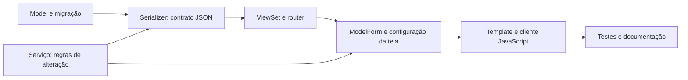

# Como ampliar o projeto

Use `Curso_Django.settings` e mantenha os apps `equipe`, `monografias` e
`home`. A aplicação usa Django templates, Bootstrap e JavaScript nativo;
não é necessário criar outro frontend para integrar uma entidade.

## Fluxo de uma integração



1. **Defina o contrato.** Identifique campos obrigatórios, relações, regras de
   exclusão, permissões e operações permitidas. Consulte o
   [backlog do plano](PENDENCIAS.md). Não transforme uma transição de processo
   em um campo livre do CRUD.
2. **Crie ou ajuste o model no app responsável.** Siga as classes
   `models.Model` existentes, com campos explícitos, `__str__`, ordenação,
   `clean()` para validação e constraints para integridade no banco.
   Use `PROTECT` nos vínculos que preservam o histórico acadêmico.
3. **Gere e revise a migração.** Execute `makemigrations equipe monografias`,
   confira o arquivo e `migrate --plan`. Para dados existentes, faça backup e
   uma migração de dados antes de tornar uma relação obrigatória. Não edite
   migrações aplicadas, não apague tabelas para contornar erros e não use
   `--fake` como correção de schema.
4. **Mapeie a entrada e a saída no serializer.** Herde de
   `ModelSerializerValidado` e enumere `Meta.fields`. Relações recebem IDs;
   campos como `curso_nome` são representações de leitura para a interface.
   Use `source` ou um método para esses campos e marque-os como somente leitura.
   Status, hashes e datas controladas pelo processo também são somente leitura.
   Nunca exponha tokens, senhas ou caminhos privados de arquivos.
5. **Centralize regras de alteração em serviços.** O serviço básico fica em
   `Curso_Django/services.py`; políticas específicas ficam no `services.py` do
   app. Vincule `service_class` ao serializer. API e formulários HTML usam a
   mesma política. Veja `MonografiaService` como exemplo real.
6. **Publique a rota.** Crie um `CRUDViewSet` em `api.py`, configure queryset,
   serializer, `search_fields` e `ordering_fields`. Use `select_related` para
   as relações apresentadas. Registre em `Curso_Django/api_urls.py` e confira
   os nomes `<basename>-list` e `<basename>-detail` usados por `reverse()`.
   Preserve as permissões administrativas até implementar a política acadêmica.
7. **Integre a tela.** Crie um `ModelForm` com campos explícitos; registre o
   recurso em `equipe/interface.py` ou `monografias/interface.py`. Informe
   títulos, instruções, queryset, serializer, nomes das rotas e colunas.
   Adicione URLs HTML com namespace, protegidas por login administrativo.
   Reutilize `templates/crud/` e o cliente `home/static/home/crud.js`.
   Os templates antigos continuam como pontos de entrada dessas páginas.
8. **Valide e documente.** Exercite criar, listar, consultar, editar e excluir;
   inclua permissões, CSRF, erros de validação, dependências protegidas e
   paginação. Atualize `CRUD.md`, este guia se o padrão mudar e `PENDENCIAS.md`.

## Responsabilidade de cada camada

| Camada | Responsabilidade |
| --- | --- |
| `models.py` | Estrutura, relações, invariantes e constraints |
| `serializers.py` | JSON ↔ tipos Python/ORM, campos aceitos, nomes para exibição |
| `services.py` | Escrita transacional e regras de alteração compartilhadas |
| `api.py` | HTTP, autorização, consultas, busca e ordenação |
| `api_urls.py` | Prefixos e nomes das rotas REST |
| `forms.py` | Campos, rótulos, widgets e validação do formulário HTML |
| `interface.py` | Mapeamento explícito entre recurso, tela e endpoint |
| `views.py` e `urls.py` | Páginas, proteção de acesso e endereços HTML |
| `templates/crud/` e `crud.js` | Apresentação e consumo da API pela sessão |

## Serviços de processo futuros

O CRUD não implementa submissão, aprovação, convites nem publicação. Ao adicionar
essas ações, crie métodos com intenção explícita, como
`MonografiaService.submeter(monografia, ator)`. A assinatura é uma orientação;
esse método ainda não existe.

O método deve verificar o papel e o vínculo do ator, bloquear o registro com
`select_for_update()` dentro de `transaction.atomic()`, validar o estado e as
pré-condições, executar a mudança e gravar `HistoricoAcao` na mesma transação.
Uma `@action` do ViewSet deve apenas validar a entrada, chamar o serviço e
serializar a resposta. Notificações externas, se implementadas em outra etapa,
devem ocorrer após o commit. Não coloque decisões de negócio em JavaScript.

## Contrato do navegador

O cliente usa URLs geradas pelo Django, `fetch` na mesma origem, cookie de sessão
e `X-CSRFToken` nas escritas. Listas leem `results`, `count`, `next` e `previous`;
nenhuma tela deve assumir que todos os registros cabem na primeira página.
Formulários enviam somente seus campos editáveis; relações vazias opcionais
viram `null`, palavras-chave viram uma lista e datas de banca usam o horário
de São Paulo. Erros devem permanecer na tela sem descartar o preenchimento.

As opções dos relacionamentos são renderizadas por `ModelChoiceField` do Django,
com nomes legíveis e queryset otimizado; não dependem da primeira página da API.
Formulários também aceitam POST HTML se o JavaScript estiver indisponível.

## Verificação local

```bash
env/bin/python scripts/postgres_local.py start --test-database
env/bin/python manage.py migrate
env/bin/python manage.py check
env/bin/python manage.py makemigrations --check --dry-run
env/bin/python manage.py test --keepdb --noinput
git diff --check
```

O banco de testes é separado do banco da aplicação. Não execute limpeza ou
fixtures de teste em `curso_django_dev`. Para conferir a interface, crie uma
conta com `createsuperuser`, entre em `/entrar/` e siga a sequência indicada
na página inicial. Teste também erro de vínculo, sessão expirada, navegação
por teclado e tela estreita.

## Testes no navegador

Os testes de `home/test_browser.py` são opcionais e rodam em um servidor
temporário sobre o banco de testes. Instale as dependências de desenvolvimento:

```bash
env/bin/python -m pip install -r requirements-dev.txt
```

O teste usa Google Chrome ou Chromium se instalado no sistema. Caso nenhum
esteja disponível, instale o navegador do Playwright:

```bash
env/bin/python -m playwright install chromium
```

Execute:

```bash
RUN_BROWSER_TESTS=1 env/bin/python manage.py test home.test_browser --keepdb --noinput
```

Há cobertura do CRUD dos oito recursos com chamadas JSON reais, busca,
paginação, vínculos protegidos, erros por campo, datas de banca, sessão expirada,
falha de rede, escape de conteúdo e navegação em tela estreita. Para capturas
locais, acrescente `BROWSER_ARTIFACTS=/tmp/monografias-ui` ao comando. Chrome e
servidor temporário são encerrados pelo teste; não ocupam a porta 8000.

## Exemplo de mapeamento existente

Em `AlunoSerializer`, a entrada `curso` recebe a chave do curso. A saída
`curso_nome` usa `source='curso.nome'` e `read_only=True`. Em
`equipe/interface.py`, a coluna `('curso_nome', 'Curso')` apresenta esse nome;
o `AlunoForm` mantém `curso` como `ModelChoiceField`, enviando o ID selecionado.
Assim, rótulo visual e vínculo persistido têm responsabilidades distintas.

Em `MonografiaSerializer`, `service_class = MonografiaService` aplica a regra
de edição apenas de rascunhos. O serviço herda criação, alteração e exclusão
transacionais de `ServicoCRUD`; atualizações e exclusões bloqueiam e releem o
registro antes de conferir o estado. No HTML, o helper em
`Curso_Django/interface.py` chama esse mesmo serviço após validar o ModelForm.

---
## Integração da autenticação acadêmica — atualização de 20/11/2026

A implementação de autenticação/segurança vem sendo organizada no app `usuarios`, sem substituir `equipe`, `monografias` ou as telas administrativas. O mesmo `auth.User` serve de identidade; os vínculos com `Aluno`, `Professor` e `Curso` permitem reconhecer os papéis acadêmicos.

### Rotas e responsabilidades

| Componente | Responsabilidade |
| --- | --- |
| `usuarios/roles.py` | Identificação dos papéis por grupos e vínculos acadêmicos |
| `usuarios/permissions.py` | Classes de permissão por papel e relação com o objeto |
| `usuarios/views.py` e `usuarios/templates/usuarios/painel.html` | Painel do usuário |
| `usuarios/api.py` e `usuarios/api_urls.py` | APIs próprias da conta e ações acadêmicas |
| `Curso_Django/urls.py` | Inclusão das rotas `accounts/`, `usuarios/` e `api/usuarios/` |
| `templates/base.html` e `templates/navbar.html` | Layout e navegação compartilhados |

O login administrativo legado está em `/entrar/`; o login `django-allauth`, em `/accounts/login/`. **Ainda é preciso confirmar a decisão final sobre manter ambos ou apresentar um único login**. Para integrar as novas telas, reutilizar `` e proteger as views e APIs no servidor. Ocultar links não substitui autorização.

As oito APIs de CRUD existentes continuam sob permissão administrativa. Para ações de alunos, orientadores e coordenadores, criar endpoints específicos e aplicar as verificações de titularidade e estado. Evitar permitir alterações diretas de status por `PATCH` no CRUD.

### Restrição por IP/VPN

Por decisão posterior, foi solicitada a remoção de `RedeAdministrativaMiddleware`, `ADMIN_NETWORK_RESTRICTION_ENABLED` e `ADMIN_ALLOWED_CIDRS`. O último `grep` informado mostrou apenas referências no script legado `scripts/proteger_settings.py`, cuja exclusão foi orientada. **Confirmar a exclusão antes de considerar a limpeza concluída.** Manter os demais middlewares e ajustes de segurança do Django.

### Inicialização no Ubuntu

Na raiz do projeto:

```bash
source .venv/bin/activate
python scripts/postgres_local.py start
python manage.py migrate
python manage.py check
python manage.py runserver
```

A instância local PostgreSQL foi configurada para a porta `5433`. A aplicação Django usa normalmente `http://127.0.0.1:8000/`; os endereços de login são `/entrar/` e `/accounts/login/`, e o painel fica em `/usuarios/painel/`.

Para testes com banco separado:

```bash
python scripts/postgres_local.py start --test-database
python manage.py test --keepdb --noinput
```

**Observação sobre testes:** uma execução relatada anteriormente teve 60 testes e um erro PostgreSQL (`FOR UPDATE cannot be applied to nullable side of outer join`) na emissão de token de convite. Não considerar a suíte integral aprovada sem nova execução após a correção.

### Próxima integração visual

Reutilizar o layout Bootstrap e a navbar já existentes, disponibilizar link ao painel para usuários autenticados sem `is_staff` e manter links administrativos apenas para staff. Confirmar a estratégia de login com a equipe antes de editar as telas.
