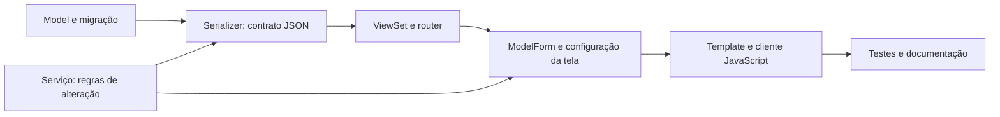

# Como ampliar o projeto

Revisado em **20/11/2026**, após `5f7857b` e a entrega dos perfis. Use `Curso_Django.settings` e
mantenha os apps `equipe`, `monografias`, `home` e `usuarios`. A aplicação usa Django templates, Bootstrap e JavaScript nativo;
não é necessário criar outro frontend para integrar uma entidade.

## Preparar o ambiente e atualizar após um pull

Siga o [README](README.md) para instalar dependências, preencher `.env`,
iniciar PostgreSQL, aplicar migrações e executar `configurar_grupos`.
`python-dotenv` e `django-allauth` foram adicionados na entrega de autenticação;
atualizar o Git não instala os pacotes nem cria `.env`. Não sobrescreva a
configuração local ou troque a senha do banco apenas para copiar um exemplo.

A chave e a senha vêm de `DJANGO_SECRET_KEY` e `POSTGRES_PASSWORD`; variáveis
exportadas no terminal prevalecem sobre `.env`. Para HTTP local, use
`DJANGO_DEBUG=1`; o padrão `0` ativa redirecionamento HTTPS/cookies seguros.
O script de PostgreSQL importa os settings, portanto também depende desse
arquivo antes de executar qualquer ação. `start` não muda a senha de um usuário
PostgreSQL existente. Os testes usam `test_curso_django_dev` com `--keepdb`.

A configuração única é `Curso_Django`. O pacote antigo `cursodjango`, o
conversor/patch obsoletos e o alias `requeriments.txt` foram removidos. Use apenas
`requirements.txt`; `.env` e `db.sqlite3.backup` são arquivos locais ignorados.
As migrações e o model Equipe continuam preservados para a migração mapeada.

## Fluxo de uma integração



1. **Defina o contrato.** Identifique campos obrigatórios, relações, regras de
   exclusão, permissões e operações permitidas. Consulte o
   [backlog do plano](PENDENCIAS.md). Não transforme uma transição de processo
   em um campo livre do CRUD.
2. **Crie ou ajuste o model no app responsável.** Siga as classes
   `models.Model` existentes, com campos explícitos, `__str__`, ordenação,
   `clean()` para validação e constraints para integridade no banco.
   Use `PROTECT` nos vínculos que preservam o histórico acadêmico.
3. **Gere e revise a migração.** Execute `makemigrations equipe monografias`,
   confira o arquivo e `migrate --plan`. Para dados existentes, faça backup e
   uma migração de dados antes de tornar uma relação obrigatória. Não edite
   migrações aplicadas, não apague tabelas para contornar erros e não use
   `--fake` como correção de schema.
4. **Mapeie a entrada e a saída no serializer.** Herde de
   `ModelSerializerValidado` e enumere `Meta.fields`. Relações recebem IDs;
   campos como `curso_nome` são representações de leitura para a interface.
   Use `source` ou um método para esses campos e marque-os como somente leitura.
   Status, hashes e datas controladas pelo processo também são somente leitura.
   Não exponha senhas, hashes de convite ou caminhos privados. A exceção
   explícita é a resposta de emissão autorizada do convite, que entrega o token
   em claro uma vez; preserve esse contrato sem incluir o segredo nas listas.
5. **Centralize regras de alteração em serviços.** O serviço básico fica em
   `Curso_Django/services.py`; políticas específicas ficam no `services.py` do
   app. Vincule `service_class` ao serializer. API e formulários HTML usam a
   mesma política. Veja `MonografiaService` como exemplo real.
6. **Publique a rota.** Crie um `CRUDViewSet` em `api.py`, configure queryset,
   serializer, `search_fields` e `ordering_fields`. Use `select_related` para
   as relações apresentadas. Registre em `Curso_Django/api_urls.py` e confira
   os nomes `<basename>-list` e `<basename>-detail` usados por `reverse()`.
   Nos CRUDs administrativos, preserve `IsAuthenticated`/`IsAdminUser`.
   Para acesso acadêmico, siga o padrão de rotas separadas em `usuarios`, com
   permissão por papel, queryset limitado ao ator e checagem por objeto.
7. **Integre a tela.** Crie um `ModelForm` com campos explícitos; registre o
   recurso em `equipe/interface.py` ou `monografias/interface.py`. Informe
   títulos, instruções, queryset, serializer, nomes das rotas e colunas.
   Adicione URLs HTML com namespace, protegidas por login administrativo.
   Reutilize `templates/crud/` e o cliente `home/static/home/crud.js`.
   Os templates antigos continuam como pontos de entrada dessas páginas.
8. **Valide e documente.** Exercite criar, listar, consultar, editar e excluir;
   inclua permissões, CSRF, erros de validação, dependências protegidas e
   paginação. Atualize `CRUD.md`, este guia, `COMMITS.md` e o README quando
   necessário. Atualize `PENDENCIAS.md` na raiz e sincronize sua cópia em docs;
   `docs/` continua ignorada pelo Git; os documentos canônicos ficam na raiz
   e são compartilhados no repositório.

## Responsabilidade de cada camada

| Camada | Responsabilidade |
| --- | --- |
| `models.py` | Estrutura, relações, invariantes e constraints |
| `serializers.py` | JSON ↔ tipos Python/ORM, campos aceitos, nomes para exibição |
| `services.py` | Escrita transacional e regras de alteração compartilhadas |
| `api.py` | HTTP, autorização, consultas, busca e ordenação |
| `api_urls.py` | Prefixos e nomes das rotas REST |
| `forms.py` | Campos, rótulos, widgets e validação do formulário HTML |
| `interface.py` | Mapeamento explícito entre recurso, tela e endpoint |
| `views.py` e `urls.py` | Páginas, proteção de acesso e endereços HTML |
| `templates/crud/` e `crud.js` | Apresentação e consumo da API administrativa pela sessão |
| `usuarios/roles.py` e `permissions.py` | Papéis por vínculo, administrador explícito e permissões acadêmicas |
| `usuarios/api.py`, `jwt_api.py` e `api_urls.py` | Identidade, consultas por vínculo, rascunhos, convites e emissor JWT para serviço separado |
| `usuarios/consultas.py` | Queryset de trabalhos visíveis compartilhado por HTML/API |
| `usuarios/services.py` | Rascunhos e convites com autorização, transação e auditoria |
| `usuarios/forms.py`, `views.py`, templates e CSS | Painéis, formulários e confirmação externa |
| `usuarios/convites.py` | Geração, hash, prazo e comparação de tokens |
| `usuarios/auditoria.py` e `signals.py` | Auditoria de CRUD e sinais de login/logout |
| `configurar_grupos` | Criação idempotente dos grupos acadêmicos e Administradores |

## Autorização e provisão de perfis

O usuário padrão `auth.User` continua como identidade. Conta ativa recebe
Aluno/Professor pelos vínculos `Aluno.usuario`/`Professor.usuario` e Coordenador
quando seu professor é indicado em `Curso.coordenador`. Os vínculos são a fonte
de verdade: grupos acadêmicos não concedem nem são pré-requisitos do papel.
Administrador exige superusuário ou grupo explícito `Administradores`.
`is_staff` não altera esses papéis nem oculta vínculos acadêmicos coexistentes.

Allauth cria a conta sem privilégios. A administração associa **Conta de acesso**
nos formulários de aluno/professor, disponíveis com JavaScript/API ou POST HTML.
Selecionar o coordenador do curso habilita também a coordenação. As escritas
via CRUD são auditadas. Remover/trocar um vínculo revoga o acesso na próxima
requisição, sem cache de papel na sessão. Não inferir vínculo por nome ou e-mail.

`eh_administrador` é compartilhado por `IsAdministrador`, decorator HTML,
context processor de menus e `AdministracaoAcademica`. O admin Django usa
`usuarios.apps.AdministracaoConfig`: exige papel administrativo, `is_staff` e
as permissões Django usuais. Seu formulário também rejeita staff sem papel,
evitando aceitar login que seria imediatamente bloqueado pelo AdminSite.
O comando `configurar_grupos` apenas cria grupos, incluindo `Administradores`;
não promove contas existentes. Não migrar staff automaticamente para esse grupo.

`monografias_visiveis` combina os escopos com `Q` e `distinct()` para API e HTML;
`RascunhoAlunoViewSet` limita o queryset ao dono e usa `IsDonoMonografia`.
Na criação, o serializer injeta aluno/curso no servidor. Campos de leitura
presentes no JSON são rejeitados, em vez de serem aceitos silenciosamente.
A listagem de rascunhos inclui trabalhos próprios em outros estados, mas
`MonografiaService` só permite editar/excluir em RASCUNHO.

As permissões de orientador, coordenador de monografia e professor avaliador
estão definidas, mas ainda não conectadas a ações desses processos. Ao usá-las,
chame `get_object()`/`check_object_permissions()` e filtre também as listas;
`has_object_permission()` sozinho não protege listagem nem criação.

`ACCOUNT_EMAIL_VERIFICATION='optional'` é a decisão atual, integrada em
`0178003`/`5f7857b`. O login de conta não confirmada foi testado pela interface
Django e no navegador. `/accounts/login/`, `/entrar/` e `/api-auth/login/`
usam a mesma view allauth e `templates/account/login.html`; o destino padrão é
`/usuarios/painel/`, ou um `next` local validado. Todos os logouts do sistema/API
exigem POST/CSRF para encerrar a sessão e retornam ao login. GET em
`/accounts/logout/` preserva a confirmação do allauth sem encerrar a sessão.
A API navegável inclui os mesmos links.

`AutenticacaoBasica` só aceita Basic sem sessão e fora das requisições de navegador
(Fetch Metadata, `Accept: text/html` ou `X-Requested-With`). Assim, credenciais
retidas não substituem a sessão e não contornam a proteção CSRF de
`SessionAuthentication`. Clientes curl/Postman sem sessão continuam usando Basic.
`/admin/` mantém o login próprio da administração Django.

A permissão padrão da API exige autenticação; `CRUDViewSet` exige também
`IsAdministrador` explicitamente. Os endpoints acadêmicos mantêm suas permissões
por papel/objeto e o router usa `RaizAPIPorPerfil` para listar recursos autorizados.
Nas telas administrativas, `administrador_required` redireciona anônimos ao
login e retorna 403 para autenticados sem papel Administrador, evitando ciclos de redirect.
Recuperação de senha completa e integração/validação de JWT entre serviços
continuam no backlog. O PR #4 adicionou `TokenMicroservicoView`, acessível
por sessão/CSRF, com seleção de um papel autorizado, claims acadêmicas e
validade de dez minutos. Exige `MICROSERVICO_JWT_SIGNING_KEY` compartilhada
(32+ caracteres); com chave ausente/curta devolve 503. O endpoint emite, mas
não prova que o microserviço confere/revoga tokens ou reconcilia IDs/estados.

## Cadastro público de contas

`/accounts/signup/` mantém a view de cadastro do allauth, configurada com
`ACCOUNT_FORMS['signup'] = 'usuarios.forms.CadastroContaForm'`. A classe
preserva as validações e o hash de senha da biblioteca. Seu `save()` envolve
a conta `auth.User`, o `EmailAddress` e a auditoria `USUARIO_CRIADO` em uma
transação; falha de uma dessas escritas desfaz o conjunto. Não crie uma segunda
tabela de identidade para o formulário: a conta deve aparecer no CRUD nativo
`/admin/auth/user/` e ser usada no login e na API.

O template `account/signup.html` envia POST com CSRF ao próprio endpoint,
sem depender do JavaScript dos CRUDs. Exibe erros gerais e por campo, conserva
usuário/e-mail e não reexibe senhas. `user_signed_up` acrescenta a confirmação
de sucesso, e o usuário segue para o painel. O cadastro não atribui staff,
superusuário, grupos ou vínculos acadêmicos enviados pelo cliente.

`usuarios/test_cadastro.py` verifica persistência, login após logout, listagem
administrativa, duplicados, senha fraca/divergente, CSRF, privilégios, rollback
e redirect externo. O cenário Chrome percorre o link do login, corrige um
formulário inválido, salva, entra novamente e confere a conta na administração.
Os dados de teste são gravados somente em `test_curso_django_dev`.

## Serviços de processo e transações

Rascunhos do aluno e emissão/confirmação de convites externos já existem.
A aprovação necessária para liberar o convite ainda não tem endpoint;
submissão, aprovação, realização, fechamento e publicação seguem pendentes.
Ao adicionar essas ações, crie métodos com intenção explícita, como
`MonografiaService.submeter(monografia, ator)`. A assinatura é uma orientação;
esse método ainda não existe.

O método deve verificar o papel e o vínculo do ator, bloquear o registro com
`select_for_update()` dentro de `transaction.atomic()`, validar o estado e as
pré-condições, executar a mudança e gravar `HistoricoAcao` na mesma transação.
Uma `@action` do ViewSet deve apenas validar a entrada, chamar o serviço e
serializar a resposta. Notificações externas, se implementadas em outra etapa,
devem ocorrer após o commit. Não coloque decisões de negócio em JavaScript.

As regras de rascunho e convite ficam em `usuarios/services.py` e são chamadas
por HTML e API. Geração/validação do token fica em `convites.py`. O serviço de
rascunho define dono/curso, verifica posse sob bloqueio e usa `MonografiaService`.
`RascunhoAlunoViewSet` herda a tradução de erros do CRUD; o serviço registra
somente o evento acadêmico na mesma transação.

Emissão/confirmação bloqueiam a participação, mas isso não valida disponibilidade
nem resolve concorrência com reagendamento. Preserve a distinção entre essas
garantias e os fluxos futuros; não amplie permissões apenas para exibir uma tela.

## Auditoria e tokens

REST administrativo e formulários HTML chamam `registrar_acao` dentro da
transação de escrita. Os serviços acadêmicos gravam `HistoricoAcao`
na transação compartilhada por HTML/API. Login/logout são capturados pelos sinais conectados em
`UsuariosConfig.ready()`. Consulte [CRUD.md](CRUD.md) para os eventos atuais.

Não há auditoria genérica de toda escrita no ORM ou dos models no Django admin.
Os serviços básicos de CRUD não recebem o ator: chamadas diretas a eles não
produzem por si só os eventos dos helpers HTTP. Os novos serviços acadêmicos
recebem o usuário e registram os eventos de rascunho/convite. Ao criar novos caminhos de escrita,
garanta registro de ator/objeto na mesma transação e teste o rollback. A
padronização de referências, consulta autorizada e retenção está em B14.

O token externo só é retornado na emissão autorizada; persista apenas o hash,
não o exponha em logs ou eventos. A view de confirmação tem autenticação vazia
e depende da posse de token válido/escopado. Não reutilize esse acesso como
permissão geral para documentos ou avaliações. As telas de emissão e aceite já existem; não há envio automático de
e-mail nem ação de recusa/convite interno.

## Contrato do navegador

O cliente usa URLs geradas pelo Django, `fetch` na mesma origem, cookie de sessão
e `X-CSRFToken` nas escritas. Listas leem `results`, `count`, `next` e `previous`;
nenhuma tela deve assumir que todos os registros cabem na primeira página.
Formulários enviam somente seus campos editáveis; relações vazias opcionais
viram `null`, palavras-chave viram uma lista e datas de banca usam o horário
de São Paulo. Erros devem permanecer na tela sem descartar o preenchimento.

As opções dos relacionamentos são renderizadas por `ModelChoiceField` do Django,
com nomes legíveis e queryset otimizado; não dependem da primeira página da API.
Formulários também aceitam POST HTML se o JavaScript estiver indisponível.

## Verificação local

```bash
env/bin/python scripts/postgres_local.py start --test-database
env/bin/python manage.py migrate
env/bin/python manage.py configurar_grupos
env/bin/python manage.py check
env/bin/python manage.py makemigrations --check --dry-run
env/bin/python manage.py test --keepdb --noinput
git diff --check
```

O banco de testes é separado do banco da aplicação. Não execute limpeza ou
fixtures de teste em `curso_django_dev`. Para conferir a interface, crie uma
conta com `createsuperuser`, entre em `/entrar/` e siga a sequência indicada
na página inicial. Teste também erro de vínculo, sessão expirada, navegação
por teclado e tela estreita.

Resultado da entrega dos perfis em 20/11/2026: **78 testes aprovados**, com
`RUN_BROWSER_TESTS=1`, PostgreSQL e Chrome. `check` passou e não há alterações
de migração. São 19 novos testes: 17 em `usuarios/test_interface.py` e dois
em `usuarios/test_browser.py`, além dos 59 anteriores.

Após a correção de login/API: **89 testes aprovados**, incluindo dez novos
testes em `usuarios/test_login_api.py` e mais um cenário Chrome de troca de
conta. A matriz de logins desativa rate limiting apenas nessa classe de teste,
pois repete dezenas de entradas pelo mesmo IP; a aplicação e os testes Chrome
mantêm os limites do allauth.

A revisão de cadastro levou a suíte a 98 casos. A correção dos papéis conforme
o escopo acrescentou doze casos: **110 testes aprovados na suíte completa**,
incluindo seis cenários Chrome, sem casos ignorados. Após o PR #4 e cinco
testes do emissor JWT, a suíte completa passou com **115 testes**. O fluxo de cadastro no
navegador também vincula a nova conta a Professor pela tela administrativa,
faz logout/login e verifica painel/API e responsividade. Execute a regressão
de papéis isoladamente com:

```bash
env/bin/python manage.py test usuarios.test_papeis --keepdb --noinput
```

Há cobertura de login allauth sem confirmação obrigatória, conta inativa/sem
vínculo, isolamento por aluno/curso, múltiplos papéis, paginação/busca, CSRF,
rascunhos por API/HTML, auditoria/rollback, convites e responsividade. Faltam
recuperação de senha, concorrência, demais processos acadêmicos e
integração distribuída. `force_login()` em teste de autorização não comprova
por si só o login; os casos novos também executam login real pelo allauth.

## Testes no navegador

Os testes de `home/test_browser.py` e `usuarios/test_browser.py` são opcionais e rodam em um servidor
temporário sobre o banco de testes. Instale as dependências de desenvolvimento:

```bash
env/bin/python -m pip install -r requirements-dev.txt
```

O teste usa Google Chrome ou Chromium se instalado no sistema. Caso nenhum
esteja disponível, instale o navegador do Playwright:

```bash
env/bin/python -m playwright install chromium
```

Execute:

```bash
RUN_BROWSER_TESTS=1 env/bin/python manage.py test home.test_browser usuarios.test_browser --keepdb --noinput
```

Dois testes cobrem o CRUD administrativo dos oito recursos
com chamadas JSON reais, busca,
paginação, vínculos protegidos, erros por campo, datas de banca, sessão expirada,
falha de rede, escape de conteúdo e navegação em tela estreita. Para capturas
locais, acrescente `BROWSER_ARTIFACTS=/tmp/monografias-ui` ao comando. Chrome e
servidor temporário são encerrados pelo teste; não ocupam a porta 8000.
Os quatro testes de usuários cobrem cadastro público, CRUD do aluno, alternância Professor/Coordenador,
convite externo, administração e troca admin → aluno → professor sem limpar
cookies, inclusive com Basic antigo retido. Capturas dos perfis podem ser geradas com
`BROWSER_ARTIFACTS=/tmp/perfis-monografias`. Não acesse o ORM síncrono enquanto
o loop do Playwright estiver ativo; prepare fixtures antes de iniciá-lo e
confira a persistência pela API real durante o cenário.

## Exemplo de mapeamento existente

Em `AlunoSerializer`, a entrada `curso` recebe a chave do curso. A saída
`curso_nome` usa `source='curso.nome'` e `read_only=True`. Em
`equipe/interface.py`, a coluna `('curso_nome', 'Curso')` apresenta esse nome;
o `AlunoForm` mantém `curso` como `ModelChoiceField`, enviando o ID selecionado.
Assim, rótulo visual e vínculo persistido têm responsabilidades distintas.

Em `MonografiaSerializer`, `service_class = MonografiaService` aplica a regra
de edição apenas de rascunhos. O serviço herda criação, alteração e exclusão
transacionais de `ServicoCRUD`; atualizações e exclusões bloqueiam e releem o
registro antes de conferir o estado. No HTML, o helper em
`Curso_Django/interface.py` chama esse mesmo serviço após validar o ModelForm.

## Extensão das telas acadêmicas

`usuarios/views.py` valida o perfil antes de montar cada painel, e usa
`monografias_visiveis` também para detalhes. A consulta do aluno usa sua autoria;
a do professor, orientação/coorientação ou participação em banca não cancelada;
a do coordenador, o curso coordenado. A emissão de convite reutiliza
`pode_convidar_para_banca`: administrador, orientador principal ou coordenador
daquele curso. Coorientação e participação não concedem a ação de convidar.
A busca HTML tem dez resultados por página e mantém filtros na paginação.
As métricas representam o perfil e o filtro docente de vínculo, antes da busca
por texto/situação. `vinculo=orientacoes|bancas` é um filtro HTML do professor;
o detalhe com `?perfil=` respeita também o papel solicitado.

`usuarios/base.html` estende o layout existente. As abas mostram apenas papéis
válidos, mas autorização é conferida novamente nas views/serviços. Formulários
de rascunho usam o cliente `crud.js` com endpoint acadêmico e fallback POST.
Não copie lógica de autorização para JavaScript. As telas de convite usam
POST com CSRF e respostas sem cache; nunca inclua o token no endereço compartilhado.

O detalhe mostra estado e bancas, sem ações de submissão/aprovação fictícias.
Novos botões devem depender de serviço/endpoint implementado e de permissão
real do ator. Não alterar status para simular uma integração ainda ausente.

## Histórico e documentação canônica

PRs #1 (`14543ac`), #2 (`9d04dc0`) e #3 (`5f7857b`) estão na base desta entrega.
A branch `develop` local ainda está em `abf487f`; novas features precisam de uma
base atualizada e acordada. Os painéis são integrados em main após os testes.

README, CRUD, DESENVOLVIMENTO, COMMITS e PENDENCIAS ficam na raiz e são versionados.
As cópias numeradas foram consolidadas; `docs/` continua local/ignorada, com
cópias de trabalho. Preserve o PDF e demais fontes como referência histórica.
A documentação recebida sobre o microserviço está incorporada ao backlog B17
como relato externo, não como comprovação de execução. A retirada anterior de
IP/VPN pela equipe diverge do enunciado recém-anexado: o controle institucional
continua pendente. A comparação completa está em [ESCOPO_E_ACESSOS.md](ESCOPO_E_ACESSOS.md).
