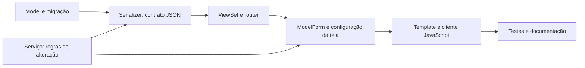

# Como ampliar o projeto

**Versionamento em 22/11/2026:** interface e B12/B13 são registrados na branch
`feature/publicacao-repositorio-b12-b13` e integrados localmente à `main`;
veja [COMMITS.md](COMMITS.md). Os documentos canônicos desta entrega agora
têm exceções no `.gitignore`. Menções abaixo a commit pendente e documentação
ignorada descrevem o estado no encerramento das implementações; push remoto
continua pendente. O novo backlog da Parte 1 será tratado após esse merge.

Revisado em **22/11/2026**, com as implementações e validações locais de B12 e B13 descritas ao final. Use `Curso_Django.settings` e
mantenha os apps `equipe`, `monografias`, `home` e `usuarios`. A aplicação usa Django templates, Bootstrap e JavaScript nativo;
não é necessário criar outro frontend para integrar uma entidade.

## Preparar o ambiente e atualizar após um pull

Siga o [README](../README.md) para instalar dependências, preencher `.env`,
iniciar PostgreSQL, aplicar migrações e executar `configurar_grupos`.
`python-dotenv` e `django-allauth` foram adicionados na entrega de autenticação;
atualizar o Git não instala os pacotes nem cria `.env`. Não sobrescreva a
configuração local ou troque a senha do banco apenas para copiar um exemplo.

A chave e a senha vêm de `DJANGO_SECRET_KEY` e `POSTGRES_PASSWORD`; variáveis
exportadas no terminal prevalecem sobre `.env`. Para HTTP local, use
`DJANGO_DEBUG=1`; o padrão `0` ativa redirecionamento HTTPS/cookies seguros.
O script de PostgreSQL importa os settings, portanto também depende desse
arquivo antes de executar qualquer ação. `start` não muda a senha de um usuário
PostgreSQL existente. Os testes usam `test_curso_django_dev` com `--keepdb`.

A configuração única é `Curso_Django`. O pacote antigo `cursodjango`, o
conversor/patch obsoletos e o alias `requeriments.txt` foram removidos. Use apenas
`requirements.txt`; `.env` e `db.sqlite3.backup` são arquivos locais ignorados.
As migrações e o model Equipe continuam preservados para a migração mapeada.

## Fluxo de uma integração



1. **Defina o contrato.** Identifique campos obrigatórios, relações, regras de
   exclusão, permissões e operações permitidas. Consulte o
   [backlog do plano](PENDENCIAS.md). Não transforme uma transição de processo
   em um campo livre do CRUD.
2. **Crie ou ajuste o model no app responsável.** Siga as classes
   `models.Model` existentes, com campos explícitos, `__str__`, ordenação,
   `clean()` para validação e constraints para integridade no banco.
   Use `PROTECT` nos vínculos que preservam o histórico acadêmico.
3. **Gere e revise a migração.** Execute `makemigrations equipe monografias`,
   confira o arquivo e `migrate --plan`. Para dados existentes, faça backup e
   uma migração de dados antes de tornar uma relação obrigatória. Não edite
   migrações aplicadas, não apague tabelas para contornar erros e não use
   `--fake` como correção de schema.
4. **Mapeie a entrada e a saída no serializer.** Herde de
   `ModelSerializerValidado` e enumere `Meta.fields`. Relações recebem IDs;
   campos como `curso_nome` são representações de leitura para a interface.
   Use `source` ou um método para esses campos e marque-os como somente leitura.
   Status, hashes e datas controladas pelo processo também são somente leitura.
   Não exponha senhas, hashes de convite ou caminhos privados. A exceção
   explícita é a resposta de emissão autorizada do convite, que entrega o token
   em claro uma vez; preserve esse contrato sem incluir o segredo nas listas.
5. **Centralize regras de alteração em serviços.** O serviço básico fica em
   `Curso_Django/services.py`; políticas específicas ficam no `services.py` do
   app. Vincule `service_class` ao serializer. API e formulários HTML usam a
   mesma política. Veja `MonografiaService` como exemplo real.
6. **Publique a rota.** Crie um `CRUDViewSet` em `api.py`, configure queryset,
   serializer, `search_fields` e `ordering_fields`. Use `select_related` para
   as relações apresentadas. Registre em `Curso_Django/api_urls.py` e confira
   os nomes `<basename>-list` e `<basename>-detail` usados por `reverse()`.
   Nos CRUDs administrativos, preserve `IsAuthenticated`/`IsAdminUser`.
   Para acesso acadêmico, siga o padrão de rotas separadas em `usuarios`, com
   permissão por papel, queryset limitado ao ator e checagem por objeto.
7. **Integre a tela.** Crie um `ModelForm` com campos explícitos; registre o
   recurso em `equipe/interface.py` ou `monografias/interface.py`. Informe
   títulos, instruções, queryset, serializer, nomes das rotas e colunas.
   Adicione URLs HTML com namespace, protegidas por login administrativo.
   Reutilize `templates/crud/` e o cliente `home/static/home/crud.js`.
   Os templates antigos continuam como pontos de entrada dessas páginas.
8. **Valide e documente.** Exercite criar, listar, consultar, editar e excluir;
   inclua permissões, CSRF, erros de validação, dependências protegidas e
   paginação. Atualize `CRUD.md`, este guia, `COMMITS.md` e o README quando
   necessário. Atualize `PENDENCIAS.md` na raiz e sincronize sua cópia em docs;
   `docs/` continua ignorada pelo Git; os documentos canônicos ficam na raiz
   e são compartilhados no repositório.

## Responsabilidade de cada camada

| Camada | Responsabilidade |
| --- | --- |
| `models.py` | Estrutura, relações, invariantes e constraints |
| `serializers.py` | JSON ↔ tipos Python/ORM, campos aceitos, nomes para exibição |
| `services.py` | Escrita transacional e regras de alteração compartilhadas |
| `api.py` | HTTP, autorização, consultas, busca e ordenação |
| `api_urls.py` | Prefixos e nomes das rotas REST |
| `forms.py` | Campos, rótulos, widgets e validação do formulário HTML |
| `interface.py` | Mapeamento explícito entre recurso, tela e endpoint |
| `views.py` e `urls.py` | Páginas, proteção de acesso e endereços HTML |
| `templates/crud/` e `crud.js` | Apresentação e consumo da API administrativa pela sessão |
| `usuarios/roles.py` e `permissions.py` | Papéis por vínculo, administrador explícito e permissões acadêmicas |
| `usuarios/api.py`, `jwt_api.py` e `api_urls.py` | Identidade, consultas por vínculo, rascunhos, convites e emissor JWT para serviço separado |
| `usuarios/consultas.py` | Queryset de trabalhos visíveis compartilhado por HTML/API |
| `usuarios/services.py` | Rascunhos e convites com autorização, transação e auditoria |
| `usuarios/forms.py`, `views.py`, templates e CSS | Painéis, formulários e confirmação externa |
| `usuarios/convites.py` | Geração, hash, prazo e comparação de tokens |
| `usuarios/auditoria.py` e `signals.py` | Auditoria de CRUD e sinais de login/logout |
| `configurar_grupos` | Criação idempotente dos grupos acadêmicos e Administradores |

## Autorização e provisão de perfis

O usuário padrão `auth.User` continua como identidade. Conta ativa recebe
Aluno/Professor pelos vínculos `Aluno.usuario`/`Professor.usuario` e Coordenador
quando seu professor é indicado em `Curso.coordenador`. Os vínculos são a fonte
de verdade: grupos acadêmicos não concedem nem são pré-requisitos do papel.
Administrador exige superusuário ou grupo explícito `Administradores`.
`is_staff` não altera esses papéis nem oculta vínculos acadêmicos coexistentes.

Allauth cria a conta sem privilégios. A administração associa **Conta de acesso**
nos formulários de aluno/professor, disponíveis com JavaScript/API ou POST HTML.
Selecionar o coordenador do curso habilita também a coordenação. As escritas
via CRUD são auditadas. Remover/trocar um vínculo revoga o acesso na próxima
requisição, sem cache de papel na sessão. Não inferir vínculo por nome ou e-mail.

`eh_administrador` é compartilhado por `IsAdministrador`, decorator HTML,
context processor de menus e `AdministracaoAcademica`. O admin Django usa
`usuarios.apps.AdministracaoConfig`: exige papel administrativo, `is_staff` e
as permissões Django usuais. Seu formulário também rejeita staff sem papel,
evitando aceitar login que seria imediatamente bloqueado pelo AdminSite.
O comando `configurar_grupos` apenas cria grupos, incluindo `Administradores`;
não promove contas existentes. Não migrar staff automaticamente para esse grupo.

`monografias_visiveis` combina os escopos com `Q` e `distinct()` para API e HTML;
`RascunhoAlunoViewSet` limita o queryset ao dono e usa `IsDonoMonografia`.
Na criação, o serializer injeta aluno/curso no servidor. Campos de leitura
presentes no JSON são rejeitados, em vez de serem aceitos silenciosamente.
A listagem de rascunhos inclui trabalhos próprios em outros estados, mas
`MonografiaService` só permite editar/excluir em RASCUNHO.

As permissões de orientador, coordenador de monografia e professor avaliador
estão definidas, mas ainda não conectadas a ações desses processos. Ao usá-las,
chame `get_object()`/`check_object_permissions()` e filtre também as listas;
`has_object_permission()` sozinho não protege listagem nem criação.

`ACCOUNT_EMAIL_VERIFICATION='optional'` é a decisão atual, integrada em
`0178003`/`5f7857b`. O login de conta não confirmada foi testado pela interface
Django e no navegador. `/accounts/login/`, `/entrar/` e `/api-auth/login/`
usam a mesma view allauth e `templates/account/login.html`; o destino padrão é
`/usuarios/painel/`, ou um `next` local validado. Todos os logouts do sistema/API
exigem POST/CSRF para encerrar a sessão e retornam ao login. GET em
`/accounts/logout/` preserva a confirmação do allauth sem encerrar a sessão.
A API navegável inclui os mesmos links.

`AutenticacaoBasica` só aceita Basic sem sessão e fora das requisições de navegador
(Fetch Metadata, `Accept: text/html` ou `X-Requested-With`). Assim, credenciais
retidas não substituem a sessão e não contornam a proteção CSRF de
`SessionAuthentication`. Clientes curl/Postman sem sessão continuam usando Basic.
`/admin/` mantém o login próprio da administração Django.

A permissão padrão da API exige autenticação; `CRUDViewSet` exige também
`IsAdministrador` explicitamente. Os endpoints acadêmicos mantêm suas permissões
por papel/objeto e o router usa `RaizAPIPorPerfil` para listar recursos autorizados.
Nas telas administrativas, `administrador_required` redireciona anônimos ao
login e retorna 403 para autenticados sem papel Administrador, evitando ciclos de redirect.
Recuperação de senha completa e integração/validação de JWT entre serviços
continuam no backlog. O PR #4 adicionou `TokenMicroservicoView`, acessível
por sessão/CSRF, com seleção de um papel autorizado, claims acadêmicas e
validade de dez minutos. Exige `MICROSERVICO_JWT_SIGNING_KEY` compartilhada
(32+ caracteres); com chave ausente/curta devolve 503. O endpoint emite, mas
não prova que o microserviço confere/revoga tokens ou reconcilia IDs/estados.

## Cadastro público de contas

`/accounts/signup/` mantém a view de cadastro do allauth, configurada com
`ACCOUNT_FORMS['signup'] = 'usuarios.forms.CadastroContaForm'`. A classe
preserva as validações e o hash de senha da biblioteca. Seu `save()` envolve
a conta `auth.User`, o `EmailAddress` e a auditoria `USUARIO_CRIADO` em uma
transação; falha de uma dessas escritas desfaz o conjunto. Não crie uma segunda
tabela de identidade para o formulário: a conta deve aparecer no CRUD nativo
`/admin/auth/user/` e ser usada no login e na API.

O template `account/signup.html` envia POST com CSRF ao próprio endpoint,
sem depender do JavaScript dos CRUDs. Exibe erros gerais e por campo, conserva
usuário/e-mail e não reexibe senhas. `user_signed_up` acrescenta a confirmação
de sucesso, e o usuário segue para o painel. O cadastro não atribui staff,
superusuário, grupos ou vínculos acadêmicos enviados pelo cliente.

`usuarios/test_cadastro.py` verifica persistência, login após logout, listagem
administrativa, duplicados, senha fraca/divergente, CSRF, privilégios, rollback
e redirect externo. O cenário Chrome percorre o link do login, corrige um
formulário inválido, salva, entra novamente e confere a conta na administração.
Os dados de teste são gravados somente em `test_curso_django_dev`.

## Serviços de processo e transações

Rascunhos do aluno e emissão/confirmação de convites externos já existem.
A aprovação necessária para liberar o convite ainda não tem endpoint;
submissão, aprovação, realização, fechamento e publicação seguem pendentes.
Ao adicionar essas ações, crie métodos com intenção explícita, como
`MonografiaService.submeter(monografia, ator)`. A assinatura é uma orientação;
esse método ainda não existe.

O método deve verificar o papel e o vínculo do ator, bloquear o registro com
`select_for_update()` dentro de `transaction.atomic()`, validar o estado e as
pré-condições, executar a mudança e gravar `HistoricoAcao` na mesma transação.
Uma `@action` do ViewSet deve apenas validar a entrada, chamar o serviço e
serializar a resposta. Notificações externas, se implementadas em outra etapa,
devem ocorrer após o commit. Não coloque decisões de negócio em JavaScript.

As regras de rascunho e convite ficam em `usuarios/services.py` e são chamadas
por HTML e API. Geração/validação do token fica em `convites.py`. O serviço de
rascunho define dono/curso, verifica posse sob bloqueio e usa `MonografiaService`.
`RascunhoAlunoViewSet` herda a tradução de erros do CRUD; o serviço registra
somente o evento acadêmico na mesma transação.

Emissão/confirmação bloqueiam a participação, mas isso não valida disponibilidade
nem resolve concorrência com reagendamento. Preserve a distinção entre essas
garantias e os fluxos futuros; não amplie permissões apenas para exibir uma tela.

## Auditoria e tokens

REST administrativo e formulários HTML chamam `registrar_acao` dentro da
transação de escrita. Os serviços acadêmicos gravam `HistoricoAcao`
na transação compartilhada por HTML/API. Login/logout são capturados pelos sinais conectados em
`UsuariosConfig.ready()`. Consulte [CRUD.md](CRUD.md) para os eventos atuais.

Não há auditoria genérica de toda escrita no ORM ou dos models no Django admin.
Os serviços básicos de CRUD não recebem o ator: chamadas diretas a eles não
produzem por si só os eventos dos helpers HTTP. Os novos serviços acadêmicos
recebem o usuário e registram os eventos de rascunho/convite. Ao criar novos caminhos de escrita,
garanta registro de ator/objeto na mesma transação e teste o rollback. A
padronização de referências, consulta autorizada e retenção está em B14.

O token externo só é retornado na emissão autorizada; persista apenas o hash,
não o exponha em logs ou eventos. A view de confirmação tem autenticação vazia
e depende da posse de token válido/escopado. Não reutilize esse acesso como
permissão geral para documentos ou avaliações. As telas de emissão e aceite já existem; não há envio automático de
e-mail nem ação de recusa/convite interno.

## Contrato do navegador

O cliente usa URLs geradas pelo Django, `fetch` na mesma origem, cookie de sessão
e `X-CSRFToken` nas escritas. Listas leem `results`, `count`, `next` e `previous`;
nenhuma tela deve assumir que todos os registros cabem na primeira página.
Formulários enviam somente seus campos editáveis; relações vazias opcionais
viram `null`, palavras-chave viram uma lista e datas de banca usam o horário
de São Paulo. Erros devem permanecer na tela sem descartar o preenchimento.

As opções dos relacionamentos são renderizadas por `ModelChoiceField` do Django,
com nomes legíveis e queryset otimizado; não dependem da primeira página da API.
Formulários também aceitam POST HTML se o JavaScript estiver indisponível.

## Verificação local

```bash
env/bin/python scripts/postgres_local.py start --test-database
env/bin/python manage.py migrate
env/bin/python manage.py configurar_grupos
env/bin/python manage.py check
env/bin/python manage.py makemigrations --check --dry-run
env/bin/python manage.py test --keepdb --noinput
git diff --check
```

O banco de testes é separado do banco da aplicação. Não execute limpeza ou
fixtures de teste em `curso_django_dev`. Para conferir a interface, crie uma
conta com `createsuperuser`, entre em `/entrar/` e siga a sequência indicada
na página inicial. Teste também erro de vínculo, sessão expirada, navegação
por teclado e tela estreita.

Resultado da entrega dos perfis em 20/11/2026: **78 testes aprovados**, com
`RUN_BROWSER_TESTS=1`, PostgreSQL e Chrome. `check` passou e não há alterações
de migração. São 19 novos testes: 17 em `usuarios/test_interface.py` e dois
em `usuarios/test_browser.py`, além dos 59 anteriores.

Após a correção de login/API: **89 testes aprovados**, incluindo dez novos
testes em `usuarios/test_login_api.py` e mais um cenário Chrome de troca de
conta. A matriz de logins desativa rate limiting apenas nessa classe de teste,
pois repete dezenas de entradas pelo mesmo IP; a aplicação e os testes Chrome
mantêm os limites do allauth.

A revisão de cadastro levou a suíte a 98 casos. A correção dos papéis conforme
o escopo acrescentou doze casos: **110 testes aprovados na suíte completa**,
incluindo seis cenários Chrome, sem casos ignorados. Após o PR #4 e cinco
testes do emissor JWT, a suíte completa passou com **115 testes**. O fluxo de cadastro no
navegador também vincula a nova conta a Professor pela tela administrativa,
faz logout/login e verifica painel/API e responsividade. Execute a regressão
de papéis isoladamente com:

```bash
env/bin/python manage.py test usuarios.test_papeis --keepdb --noinput
```

Há cobertura de login allauth sem confirmação obrigatória, conta inativa/sem
vínculo, isolamento por aluno/curso, múltiplos papéis, paginação/busca, CSRF,
rascunhos por API/HTML, auditoria/rollback, convites e responsividade. Faltam
recuperação de senha, concorrência, demais processos acadêmicos e
integração distribuída. `force_login()` em teste de autorização não comprova
por si só o login; os casos novos também executam login real pelo allauth.

## Testes no navegador

Os testes de `home/test_browser.py` e `usuarios/test_browser.py` são opcionais e rodam em um servidor
temporário sobre o banco de testes. Instale as dependências de desenvolvimento:

```bash
env/bin/python -m pip install -r requirements-dev.txt
```

O teste usa Google Chrome ou Chromium se instalado no sistema. Caso nenhum
esteja disponível, instale o navegador do Playwright:

```bash
env/bin/python -m playwright install chromium
```

Execute:

```bash
RUN_BROWSER_TESTS=1 env/bin/python manage.py test home.test_browser usuarios.test_browser --keepdb --noinput
```

Dois testes cobrem o CRUD administrativo dos oito recursos
com chamadas JSON reais, busca,
paginação, vínculos protegidos, erros por campo, datas de banca, sessão expirada,
falha de rede, escape de conteúdo e navegação em tela estreita. Para capturas
locais, acrescente `BROWSER_ARTIFACTS=/tmp/monografias-ui` ao comando. Chrome e
servidor temporário são encerrados pelo teste; não ocupam a porta 8000.
Os quatro testes de usuários cobrem cadastro público, CRUD do aluno, alternância Professor/Coordenador,
convite externo, administração e troca admin → aluno → professor sem limpar
cookies, inclusive com Basic antigo retido. Capturas dos perfis podem ser geradas com
`BROWSER_ARTIFACTS=/tmp/perfis-monografias`. Não acesse o ORM síncrono enquanto
o loop do Playwright estiver ativo; prepare fixtures antes de iniciá-lo e
confira a persistência pela API real durante o cenário.

## Exemplo de mapeamento existente

Em `AlunoSerializer`, a entrada `curso` recebe a chave do curso. A saída
`curso_nome` usa `source='curso.nome'` e `read_only=True`. Em
`equipe/interface.py`, a coluna `('curso_nome', 'Curso')` apresenta esse nome;
o `AlunoForm` mantém `curso` como `ModelChoiceField`, enviando o ID selecionado.
Assim, rótulo visual e vínculo persistido têm responsabilidades distintas.

Em `MonografiaSerializer`, `service_class = MonografiaService` aplica a regra
de edição apenas de rascunhos. O serviço herda criação, alteração e exclusão
transacionais de `ServicoCRUD`; atualizações e exclusões bloqueiam e releem o
registro antes de conferir o estado. No HTML, o helper em
`Curso_Django/interface.py` chama esse mesmo serviço após validar o ModelForm.

## Extensão das telas acadêmicas

`usuarios/views.py` valida o perfil antes de montar cada painel, e usa
`monografias_visiveis` também para detalhes. A consulta do aluno usa sua autoria;
a do professor, orientação/coorientação ou participação em banca não cancelada;
a do coordenador, o curso coordenado. A emissão de convite reutiliza
`pode_convidar_para_banca`: administrador, orientador principal ou coordenador
daquele curso. Coorientação e participação não concedem a ação de convidar.
A busca HTML tem dez resultados por página e mantém filtros na paginação.
As métricas representam o perfil e o filtro docente de vínculo, antes da busca
por texto/situação. `vinculo=orientacoes|bancas` é um filtro HTML do professor;
o detalhe com `?perfil=` respeita também o papel solicitado.

`usuarios/base.html` estende o layout existente. As abas mostram apenas papéis
válidos, mas autorização é conferida novamente nas views/serviços. Formulários
de rascunho usam o cliente `crud.js` com endpoint acadêmico e fallback POST.
Não copie lógica de autorização para JavaScript. As telas de convite usam
POST com CSRF e respostas sem cache; nunca inclua o token no endereço compartilhado.

O detalhe mostra estado, bancas e ações acadêmicas implementadas em B09–B12.
Novos botões devem depender de serviço/endpoint implementado e de permissão
real do ator. Não alterar status para simular uma integração ainda ausente.

## Histórico e documentação canônica

PRs #1 (`14543ac`), #2 (`9d04dc0`) e #3 (`5f7857b`) estão na base desta entrega.
A branch `develop` local ainda está em `abf487f`; novas features precisam de uma
base atualizada e acordada. Os painéis são integrados em main após os testes.

README e CRUD permanecem na raiz. Nesta sessão, os documentos de desenvolvimento,
escopo, histórico e pendências foram encontrados em `docs/`, pasta ainda ignorada
pelo Git. A atualização B12 foi feita nesses arquivos existentes; ela não será
incluída automaticamente em um commit. O backlog vigente é
[PENDENCIAS_SISTEMA_MONOGRAFIAS_22-11-2026.md](PENDENCIAS_SISTEMA_MONOGRAFIAS_22-11-2026.md).
Preserve o PDF e demais fontes como referência histórica.
A documentação recebida sobre o microserviço está incorporada ao backlog B17
como relato externo, não como comprovação de execução. A retirada anterior de
IP/VPN pela equipe diverge do enunciado recém-anexado: o controle institucional
continua pendente. A comparação completa está em [ESCOPO_E_ACESSOS.md](ESCOPO_E_ACESSOS.md).

## B12 — documentos, correções e publicação automática (22/11/2026)

Esta seção substitui as referências históricas a B12 ainda não implementado.
O código foi implementado, a migração foi aplicada no PostgreSQL local e os
testes de regras, navegador e comunicação real passaram. Commit e push desta
entrega ainda não foram realizados. B13 e P0-C continuam no backlog.

### Decisões aprovadas e responsabilidades

O Django principal armazena os documentos B12 e a cópia final para publicação.
O microserviço preserva o PDF original do B09. Não se envia a correção também
ao microserviço, nem se altera seu status para representar a publicação local.
`Monografia.microservico_id` mantém o vínculo entre os sistemas.

| Documento / operação | Responsável | Condição |
| --- | --- | --- |
| Enviar termo, versão corrigida e comprovante | Aluno autor | Resultado B11 aprovado e publicação ainda aberta |
| Aceitar/rejeitar versão corrigida | Orientador principal | Resultado original da banca com ressalvas |
| Conferir assinatura do termo | Coordenador do curso ou Administrador | Confirmação humana explícita do conteúdo e da assinatura |
| Enviar ata | Orientador, coordenador do curso ou Administrador | Documento opcional, não libera publicação |
| Consultar documentos e baixar versões | Aluno autor, orientador principal, coordenador do curso ou Administrador | Sessão ou autenticação válida e vínculo conferido no servidor |

Coorientadores, outros membros da banca, externos e usuários apenas `is_staff`
não ganham acesso aos documentos B12 por esses vínculos. Aceitar uma correção
não é uma permissão implícita de Administrador: exige ser o orientador responsável.

A conferência do termo é visual e humana, registrada com usuário e data. O
validador de PDF não verifica criptograficamente a assinatura. O envio isolado
do termo não conta como assinatura conferida. Rejeições exigem motivo de até
2.000 caracteres; a nova tentativa exige novo arquivo, preservando o histórico.

### Regras e transições

`usuarios/publicacao.py` concentra as regras usadas pela API e pelo HTML:

1. Exige resultado B11 encerrado: banca realizada, avaliações titulares
   finalizadas e resultado/média consistentes com `RESULTADO_BANCA_FINALIZADO`.
   Alterar somente `status_fluxo` não torna um trabalho elegível.
2. Sem ressalvas, a aceitação do termo copia o PDF original via HTTP/JWT,
   confere seu SHA-256 contra o B09 e publica automaticamente.
3. Com ressalvas, o envio da correção muda o estado para `CORRECOES_ENTREGUES`.
   O orientador aceita ou rejeita; rejeição retorna a `APROVADA_COM_RESSALVAS`.
   Aceitação deixa `APROVADA` enquanto faltar o termo conferido. O resultado
   original com ressalvas permanece preservado na banca e na publicação.
4. Correção e termo podem ser conferidos em qualquer ordem. A última condição
   satisfeita cria a publicação na mesma transação. Não há botão de publicação.
5. Uma nova versão substitui apenas a vigência da anterior e exige nova
   conferência. Reprovação, termo ausente/rejeitado, correção obrigatória
   pendente/rejeitada ou integridade inválida impedem a publicação.
6. Após publicar, arquivos e decisões ficam fixos; não há edição, substituição
   ou exclusão nas rotas B12, no CRUD de monografias ou no Django Admin.

`Publicacao` mantém uma relação única com a monografia, a banca, o PDF final e o
termo conferido, além de data/hora, ator, média, resultado original e hash final.
`Monografia.data_publicacao` usa a data local da publicação.
**`Monografia.sha256` continua sendo o hash original do B09**; para servir o
arquivo publicado, use `publicacao.documento_final` e `publicacao.sha256`.

### Arquivos, transações e auditoria

- PDFs de até **50 MB** (`DOCUMENTOS_MAX_UPLOAD_MB`), extensão `.pdf`, cabeçalho,
  estrutura legível, ao menos uma página, sem criptografia e SHA-256 calculado
  sobre os bytes recebidos. A dependência adicionada é `pypdf==6.21.4`.
- `ArmazenamentoPrivado` usa `MEDIA_ROOT`, nomes UUID e recusa URL direta.
  Downloads autorizados conferem tamanho/hash antes de entregar o arquivo,
  usam `attachment`, `private, no-store` e `nosniff`.
- O servidor/proxy de implantação **não deve publicar `MEDIA_ROOT` diretamente**.
  Os caminhos físicos não são retornados pela API. A consulta pública futura
  do B13 deve servir somente o PDF final da `Publicacao`, nunca o termo ou versões
  anteriores. Nesta entrega, inclusive o download final permanece privado.
- Cada escrita bloqueia a monografia com `select_for_update`. Há unicidade de
  documento vigente por tipo e uma publicação por monografia. Repetir a mesma
  decisão/publicação devolve o registro existente sem duplicar arquivos ou auditoria.
- Erro no banco/auditoria remove arquivos novos criados naquela operação.
  Arquivos e decisões de versões anteriores são preservados.
- Se o microserviço falhar durante a última conferência sem ressalvas, a
  confirmação e a publicação são revertidas juntas. O termo permanece pendente;
  após restabelecer o serviço, repita a conferência. HTTP 503 indica indisponibilidade;
  hash divergente, arquivo ausente/adulterado ou estado inválido resultam em 409.
- Eventos locais em `HistoricoAcao`: `DOCUMENTO_ENVIADO`, `DOCUMENTO_ACEITO`,
  `DOCUMENTO_REJEITADO` e `MONOGRAFIA_PUBLICADA`, com ator, IDs, hashes e dados
  da decisão. Essa auditoria não representa publicação de evento no RabbitMQ.
- O Admin mantém documentos/publicações somente para consulta, protege resultados
  encerrados e remove exclusão em lote desses registros. O serviço legado de
  avaliações também recusa inserção após fechamento da banca.

### Contratos e interface

Prefixo da API: `/api/usuarios/monografias/{id}/`.

| Método e sufixo | Entrada / resposta |
| --- | --- |
| `GET documentos/` | Documentos, versões, decisões e publicação, quando existente |
| `POST documentos/` | Multipart: `tipo` e `arquivo`; retorna 201 com metadados |
| `POST documentos/{documento_id}/conferir/` | JSON/form: `decisao`, `confirmacao`, `motivo`; retorna documento e publicação ou `null` |
| `GET documentos/{documento_id}/arquivo/` | Download privado com integridade verificada |

Aceitação: `{"decisao":"aceitar","confirmacao":true}`.
Rejeição: `{"decisao":"rejeitar","motivo":"Descreva o ajuste necessário."}`.
O tipo interno `ORIGINAL_APROVADA` é criado apenas pelo serviço de publicação.
Os tipos enviados pelo usuário são `TERMO_AUTORIZACAO`, `VERSAO_CORRIGIDA`,
`ATA` e `COMPROVANTE_CORRECAO`, sujeitos à matriz de permissões.

Erros: 400 para entrada inválida; 403 para falta de permissão; 404 para documento
que não pertence ao trabalho indicado; 409 para conflito de estado/integridade;
503 para falha do microserviço. Requisições de escrita com sessão exigem CSRF.

A tela `/usuarios/trabalhos/{id}/documentos/` é acessada por
**Acompanhar documentos e publicação** no detalhe do trabalho. Exibe os
requisitos, envio por papel, histórico, motivo das rejeições, confirmação explícita
e download final. Não oferece ações a papéis sem permissão; o servidor as
revalida mesmo se o cliente montar a requisição manualmente. O detalhe mantém
a média e o resultado original da banca após correção/publicação.

### Migração e execução

```bash
env/bin/pip install -r requirements.txt
env/bin/python manage.py migrate
env/bin/python manage.py check
env/bin/python manage.py makemigrations --check --dry-run
```

Migração `monografias.0006_documentos_publicacao_b12`: adiciona metadados de
conferência/versões, unicidade de vigência e `Publicacao`, preservando os
caminhos dos arquivos existentes. Documentos legados recebem `vigente=False`
e não são presumidos assinados, íntegros ou aprovados. Sem tamanho/hash confiáveis,
seu download verificado fica bloqueado; para utilizá-los no B12 é necessário
novo envio e conferência pelo fluxo autorizado. Não há promoção automática de legado.

### Evidências de validação em 22/11/2026

| Verificação executada | Resultado |
| --- | --- |
| Suíte completa após a implementação, antes de adicionar os dois testes remotos opcionais | 189 testes: 181 aprovados, 8 opcionais ignorados, zero falhas |
| `usuarios.test_publicacao` | 24/24 aprovados, incluindo concorrência real no PostgreSQL |
| `usuarios.test_publicacao_browser` com Chrome/Playwright | 2/2 aprovados; desktop 1366 px e celular 390 px; sem erros JS/overflow horizontal |
| `usuarios.test_publicacao_integrada` com dois serviços reais | 2/2 aprovados; HTTP/JWT, upload B09, aprovação, fechamento B11 e publicação B12 |
| `check`, `makemigrations --check --dry-run`, `showmigrations monografias` | Sem problemas; sem migração faltante; `0006` aplicada |

Os 24 testes B12 cobrem os dois resultados aprovados, ordem das conferências,
reprovação, estado/resultado adulterado, documentos ausentes/inválidos/grandes/
criptografados, permissões, CSRF, versões, rejeição/reenvio, idempotência,
concorrência, falha remota, transferência incompleta, hash divergente, rollback,
download privado e bloqueio de alterações no CRUD/Admin.

```bash
env/bin/python manage.py test usuarios.test_publicacao --keepdb --noinput
RUN_BROWSER_TESTS=1 BROWSER_ARTIFACTS=/tmp/allteam-b12-browser env/bin/python manage.py test usuarios.test_publicacao_browser --keepdb --noinput
```

As capturas locais são `b12-publicada-desktop.png` e `b12-publicada-mobile.png`
na pasta indicada. Os cenários de navegador criam contas reais no banco de
testes e fazem login pela tela; apenas o transporte do original é simulado.
PDFs e assinaturas usados nos testes são fixtures, não termos acadêmicos reais.

Para o teste de integração, foi usado o repositório
`https://github.com/HudsonJR777/microservico-sd.git`, revisão
`75636b4cb9ad1bcae71017dfe01b7dcca2bfb844`, clonado em `/tmp` sem alteração de
código. O projeto Docker isolado `allteam-b12-qa-20261122` iniciou web, PostgreSQL,
Redis e RabbitMQ; `/health/` confirmou banco e Redis. Foram usadas credenciais
aleatórias exclusivas desse ambiente. Containers e volumes de teste foram
descartados após os cenários, sem alterar dados acadêmicos locais existentes.

Para repetir, prepare um microserviço **descartável**, com a revisão acima,
seu `.env` e os quatro serviços do Compose ativos. Exporte
`B12_MICROSERVICO_URL` (por exemplo, `http://127.0.0.1:8001/api/`) e
`B12_JWT_SIGNING_KEY` com a chave desse ambiente, sem gravá-la na documentação:

```bash
RUN_B12_INTEGRATION=1 env/bin/python manage.py test usuarios.test_publicacao_integrada --keepdb --noinput
```

Esses dois testes não usam mocks de HTTP/JWT. Comparam o arquivo final original
com os bytes enviados e confirmam que a correção final não sobrescreve o original
remoto. A banca é preparada em data passada como fixture; realização, avaliação
e fechamento usam serviços reais B11. Não constituem validação de todo o
agendamento B10. Registros remotos ficam no ambiente descartável até sua remoção.
Não execute suítes simultâneas contra o mesmo banco de testes.

### Pendências que permanecem

No encerramento do B12, B13 ainda precisava fornecer catálogo, filtros, API e download públicos; essa entrega foi realizada na seção seguinte. P0-C ainda
deve implementar processamento/indexação de PDF, eventos de publicação,
consumidores e notificações. Não houve extração de texto, assinatura digital,
mudança de média/quórum ou implantação em produção nesta entrega. O backlog
marca P0-A como implementado e validado localmente, mantendo commit/push pendentes
conforme seu critério de entrega.

## B13 — repositório, API pública e indexação por fila (22/11/2026)

P0-B implementado e validado localmente. A entrega usa os arquivos finais e
as decisões acadêmicas do B12. As alterações de interface anteriores foram
preservadas. Commit/push desta entrega ainda não foram realizados, e `docs/`
continua ignorada pelo Git.

### Decisões de implementação

- App `repositorio` separado das APIs administrativas; endpoints somente de
  leitura, com `AllowAny` e sem autenticação HTTP. Uma credencial inválida no
  navegador não impede a consulta pública.
- A seleção pública exige **status `PUBLICADA` e registro B12 de `Publicacao`**,
  banca realizada, vínculos consistentes, termo aceito e tipo/hash do arquivo
  final compatíveis com o resultado. Um status alterado isoladamente não expõe
  o trabalho. API, detalhe, downloads e worker reutilizam essa seleção.
- Os serializers administrativos não são usados na resposta pública. São
  expostos título, resumo, palavras-chave, nome do autor, nome/ID do curso e do
  orientador, datas e metadados do PDF final. E-mail, matrícula, conta, notas,
  pareceres, termo, documentos anteriores e caminhos de armazenamento ficam privados.
- Cursos e orientadores públicos são os vinculados a trabalhos efetivamente
  publicados. Isso evita listar pessoas e cursos sem conteúdo disponível.
- A publicação aparece imediatamente pelos metadados; o texto do PDF torna-se
  pesquisável após o worker. A publicação B12 grava uma **outbox na mesma
  transação**, sem conectar ao broker ou extrair texto durante a requisição.
- Indexação inicial do B13 usa `monografia.publicada` e apenas o PDF final.
  O original de submissão, termos e versões anteriores não são indexados para
  busca pública. O consumo de `monografia.submetida` e as notificações acadêmicas
  permanecem no P0-C.

### Rotas e filtros

| Rota | Acesso e retorno |
| --- | --- |
| `/repositorio/` | Busca e resultados públicos, consumindo JSON via JavaScript |
| `/repositorio/{id}/` | Detalhe público; HTML inicial utilizável sem JS, atualizado pela API via JS |
| `GET /api/publico/monografias/` | Lista paginada de trabalhos publicados |
| `GET /api/publico/monografias/{id}/` | Dados públicos de um trabalho |
| `GET /api/publico/monografias/{id}/arquivo/` | PDF final para leitura inline |
| `GET /api/publico/monografias/{id}/arquivo/?download=1` | Download do mesmo PDF final |
| `GET /api/publico/cursos/` | Lista de `{id, nome}` dos cursos com publicações |
| `GET /api/publico/orientadores/` | Lista de `{id, nome}` dos orientadores com publicações |

`{id}` é a chave da **Monografia no principal**, não o ID do documento ou do
microserviço. Não há rota pública que receba um ID arbitrário de documento.
Tentativas de POST/PATCH/PUT/DELETE recebem 405. Recursos não publicados ou
inconsistentes recebem 404; filtros inválidos, 400; falha de integridade do
arquivo final, 409.

| Parâmetro | Semântica |
| --- | --- |
| `titulo` | Parte do título, sem diferenciar maiúsculas/minúsculas |
| `autor` | Parte do nome do aluno autor |
| `orientador` | ID de orientador retornado pela lista pública |
| `curso` | ID de curso retornado pela lista pública |
| `ano_defesa` | Ano da banca realizada, no fuso `America/Sao_Paulo`; não usa data de publicação |
| `palavras_chave` | De um a dez termos separados por vírgulas; todos devem ocorrer nas palavras-chave cadastradas |
| `busca` | Pesquisa geral em título, resumo, autor, orientador, palavras-chave e texto indexado do PDF |
| `ordering` | `-data_defesa` (padrão), `data_defesa`, `titulo`, `-titulo` ou `-data_publicacao` |
| `page`, `page_size` | Página a partir de 1; 12 registros por padrão, máximo 50 |

Os filtros são combinados com AND. Ordenações têm desempate por ID para
paginação estável. Parâmetros desconhecidos, repetidos ou fora dos limites são
rejeitados. A resposta de listagem tem `count`, `page`, `pages`, `next`,
`previous` e `results`. Página inexistente retorna 404; pesquisa sem resultados
retorna 200 com lista vazia. Campos textuais usam parâmetros do ORM, nunca SQL
montado com a entrada do visitante.

Exemplo: `/api/publico/monografias/?titulo=sistemas&autor=Maria&ano_defesa=2026&palavras_chave=redes,segurança&ordering=titulo`.

### Interface e arquivos públicos

O repositório aparece na navegação, na página inicial e no detalhe B12 de
trabalhos publicados. A interface mantém a identidade visual existente, com
busca destacada, filtros laterais, cartões, filtros removíveis, estados vazio/
carregando/erro e paginação. No celular os filtros são recolhidos inicialmente.

Filtros ficam na URL: links podem ser compartilhados, recarregados e usados com
voltar/avançar do navegador. Respostas de pesquisas antigas são canceladas ou
descartadas; erro de rede oferece nova tentativa. Falha nas listas de cursos/
orientadores tem mensagem e botão próprios, sem impedir a busca textual.
Conteúdo retornado pela API é inserido com `textContent`, preservando escape
de HTML. Contagem e falhas têm anúncios acessíveis; campos possuem rótulos e
controles de teclado. A tela de detalhe também consome a API pública, mantendo
o HTML inicial como alternativa sem JavaScript.

Leitura e download usam exclusivamente `Publicacao.documento_final`. O tamanho
e SHA-256 são verificados antes de enviar bytes. O arquivo original sem
ressalvas e a versão corrigida são cobertos nos testes. Termos, atas,
comprovantes e versões antigas continuam nas rotas privadas do B12;
`MEDIA_ROOT` não deve ser exposta pelo servidor/proxy. A API pública não usa
cache Redis nesta entrega; esse requisito e os testes de carga permanecem no P0-D.

### Outbox, RabbitMQ e busca no texto

Migrações aplicadas: `repositorio.0001_initial` e
`repositorio.0002_enfileirar_publicacoes_existentes`. A primeira cria:

- `EventoIndexacao`: UUID do evento, publicação única, hash da versão final,
  datas de criação/envio/processamento, próxima tentativa, contadores e classe
  do último erro.
- `IndicePublicacao`: publicação única, hash, texto extraído, data e vetor de
  busca PostgreSQL com índice GIN e configuração linguística `portuguese`.

A segunda cria eventos para publicações B12 que já existiam, sem duplicar
registros nem acessar o broker. A criação de novas publicações grava o evento
junto com status/data/auditoria; se a transação falhar, o evento também é desfeito.

O contrato contém `evento_id`, `tipo=monografia.publicada`, `versao=1`,
`origem=principal`, `publicacao_id`, `monografia_id`, `documento_id`, `sha256`
e `ocorrido_em`. Não inclui JWT, senha, nome de arquivo privado ou conteúdo.
O consumidor confere o contrato contra a outbox e a publicação local; mensagens
que tentam trocar o documento por um termo/versão antiga são rejeitadas.
A consulta textual também exige que o hash do índice coincida com o PDF
publicado; esse bloqueio foi confirmado por teste específico na revisão final.

O comando `processar_repositorio` publica a outbox com mensagens persistentes,
roteamento obrigatório e confirmação do broker. O consumidor confirma ACK
**após** persistir índice e conclusão do evento na mesma transação. Reentrega
do mesmo evento é idempotente. Extração roda em uma thread separada da conexão
Pika, permitindo manter os heartbeats durante o processamento do PDF.

Topologia padrão, exclusiva do B13:

| Recurso | Nome |
| --- | --- |
| Exchange de eventos | `allteam.repositorio.indexar.eventos` |
| Routing key | `monografia.publicada` |
| Fila de trabalho | `allteam.repositorio.indexar` |
| Exchange de falhas | `allteam.repositorio.indexar.falhas` |
| Fila de mensagens rejeitadas (DLQ) | `allteam.repositorio.indexar.dlq` |

`REPOSITORIO_FILA` permite trocar o prefixo. Filas e exchanges são duráveis.
As filas do microserviço B09 não foram alteradas.

Falha de envio mantém o evento no banco e agenda nova tentativa. Um envio
confirmado sem processamento concluído pode ser reenviado após cinco minutos;
isso cobre confirmação perdida, interrupção do worker e retomada. Falhas de
extração usam espera progressiva (30 s, 60 s…) e param após três falhas.
Mensagens rejeitadas ficam na DLQ. Após corrigir arquivo/configuração, use
`--repetir-falhas` para reativar eventos esgotados. Erros registrados contêm a
classe da exceção, sem mensagens externas que possam revelar credenciais.

PDFs sem camada de texto continuam disponíveis por metadados e download; OCR
não foi implementado. O worker limita a extração a 1.000.000 de caracteres por
documento (`REPOSITORIO_MAX_TEXTO`): exceder esse limite causa falha explícita,
sem armazenar um índice parcial. Falhas de leitura, parsing ou indexação não
despublicam o trabalho. O diagnóstico está em `status_repositorio` e na DLQ.

### Ambiente local preparado e operação

O integrante esclareceu que o `.env` já configurado era o do JWT, não o de
mensageria. Foram adicionadas apenas as variáveis RabbitMQ ausentes, com senha
aleatória local. A chave JWT e demais variáveis existentes foram preservadas.
Nenhuma credencial é incluída neste documento ou em arquivos versionados.

`compose.repositorio.yml` inicia um RabbitMQ próprio, com volume persistente,
health check e portas ligadas somente a `127.0.0.1`: **5673** (AMQP) e **15673**
(painel). O Compose lê `RABBITMQ_USER` e `RABBITMQ_PASSWORD`; Django/worker leem
`RABBITMQ_URL`. `.env.example` contém somente exemplos sem segredo.

```bash
env/bin/pip install -r requirements.txt
env/bin/python manage.py migrate
docker compose -f compose.repositorio.yml --project-name allteam-repositorio up -d --wait
env/bin/python -u manage.py processar_repositorio
```

O broker e o worker foram iniciados nesta sessão local. O worker deve continuar
em um processo separado do `runserver`; em outra sessão/reinício, execute o
comando acima ou configure seu gerenciador de processos. O Compose reinicia
o broker automaticamente, mas não gerencia o processo Python do worker.

```bash
# Diagnóstico sem revelar dados dos PDFs ou credenciais
env/bin/python manage.py status_repositorio
# Um ciclo, limitado a 20 envios e 20 consumos
env/bin/python manage.py processar_repositorio --uma-vez
# Reagendar falhas esgotadas após corrigir a causa
env/bin/python manage.py processar_repositorio --repetir-falhas
# Encerrar somente o broker B13, preservando seu volume
docker compose -f compose.repositorio.yml --project-name allteam-repositorio down
```

No início do worker, o banco de desenvolvimento tinha zero publicações B12;
nenhum dado demonstrativo foi inserido nesse banco. As evidências abaixo usam
contas, publicações e arquivos criados no banco de testes e pastas temporárias.

### Evidências de validação B13

| Verificação | Resultado em 22/11/2026 |
| --- | --- |
| Suíte completa padrão | **216 encontrados, 201 aprovados, 15 opcionais ignorados, zero falhas** |
| Testes B13 de API, filtros, integridade, privacidade, indexação/outbox e migração | **20/20 aprovados**, incluídos na suíte completa |
| Chrome/Playwright com visitante anônimo | **2/2 aprovados**, desktop 1440 px e celular 390 px, sem erros JS ou rolagem horizontal |
| RabbitMQ real, filas exclusivas por teste | **3/3 aprovados**: indexação/busca, redelivery, DLQ e recuperação após falha do canal |
| Configuração/migrações/JavaScript | `check` sem problemas; `makemigrations --check --dry-run` consistente; `node --check` aprovado |

```bash
env/bin/python manage.py test --keepdb --noinput
env/bin/python manage.py test repositorio.tests --keepdb --noinput
RUN_BROWSER_TESTS=1 BROWSER_ARTIFACTS=/tmp/allteam-b13-browser env/bin/python manage.py test repositorio.test_browser --keepdb --noinput
RUN_B13_INTEGRATION=1 env/bin/python manage.py test repositorio.test_integracao --keepdb --noinput
```

Os testes de RabbitMQ usam conexão real com o broker e PostgreSQL, sem mocks
do transporte: publicam eventos, extraem texto real de PDF, verificam a busca
anônima, entregam duplicatas, enviam mensagens inválidas à DLQ e recuperam envio
que falhou em canal fechado. Cada teste usa UUID no nome das filas e remove
suas filas/exchanges ao terminar. Não limpa as filas de aplicação. Execute as
suítes sequencialmente, pois compartilham o banco de testes.

Os testes de navegador cobrem os seis filtros combinados, URL/reload/voltar,
paginação, detalhe, download com SHA-256 conferido, busca por palavra presente
apenas no PDF, vazio, falhas de rede, retomada de listas e escape de HTML.
Capturas locais: `/tmp/allteam-b13-browser/b13-catalogo-desktop.png`,
`b13-catalogo-mobile.png`, `b13-detalhe-desktop.png` e `b13-detalhe-mobile.png`.
O caso de consulta/download foi repetido após conectar também o detalhe à API.

### Limites e continuidade

P0-B está implementado e validado localmente; sua entrega Git permanece pendente.
P0-C continua parcial: a indexação do PDF final, evento de publicação, outbox,
idempotência e DLQ foram entregues aqui; extração na submissão B09, notificações
de banca/aluno e demais contratos distribuídos ainda precisam ser completados.
P0-D mantém Redis para sessões/cache, invalidação e testes de carga. Não há
afirmação de suporte a milhares de acessos nem implantação em produção.

Referências técnicas usadas: [busca textual do Django/PostgreSQL](https://docs.djangoproject.com/en/6.0/ref/contrib/postgres/search/)
para vetores e consultas em português; [Pika BlockingConnection](https://pika.readthedocs.io/en/stable/modules/adapters/blocking.html)
para confirmação de publicação, ACK e uso da conexão na thread responsável.
